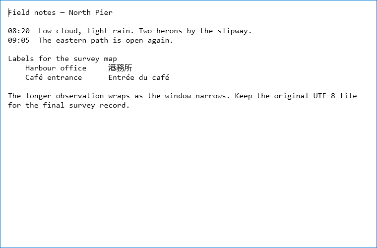

# Composia Editor

A single-document UTF-8 text editor built with a retained `TextBox`, one top-level
window, and native File and Edit menus. Run the release executable directly, or
pass a file on the command line:

```powershell
.\out\build\release\examples\composia-editor.exe .\notes.txt
```

Use Ctrl+O to open a document, Ctrl+S to save, and Ctrl+Shift+S to save a copy
under a new name. Opening another document, creating a new one, and closing the
window prompt for unsaved changes. The editor supplies selection, clipboard,
undo/redo, word wrapping, scrolling, IME, and UI Automation text ranges.

New documents use UTF-8 with CRLF. Existing documents retain their UTF-8 BOM
choice and first line-ending convention. Saving a file with mixed endings
normalizes it to that convention. Input and output are limited to 16 MiB. A save
writes and flushes a temporary file in the destination directory before replacing
the original.



The window wires document commands to the retained editor. File decoding and
replacement can be reused independently. [Editor.cpp](Editor.cpp) · [Document.cpp](Document.cpp)
